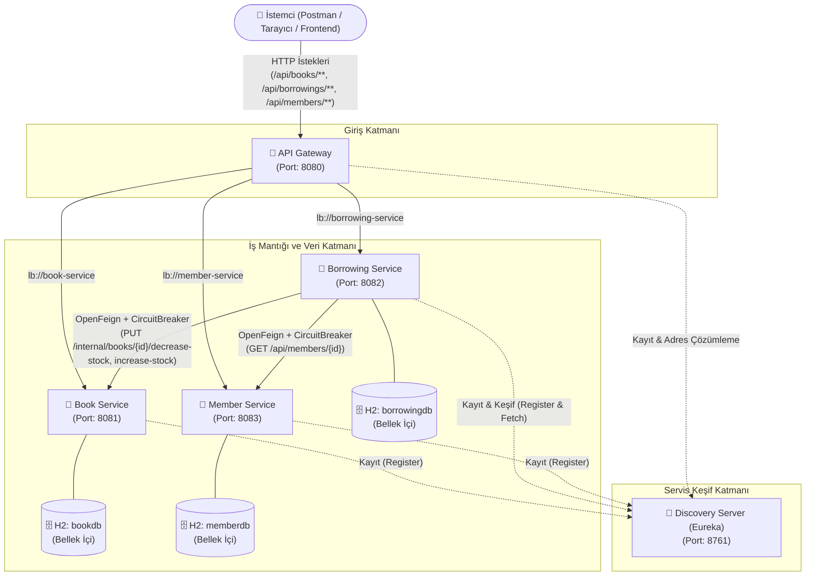
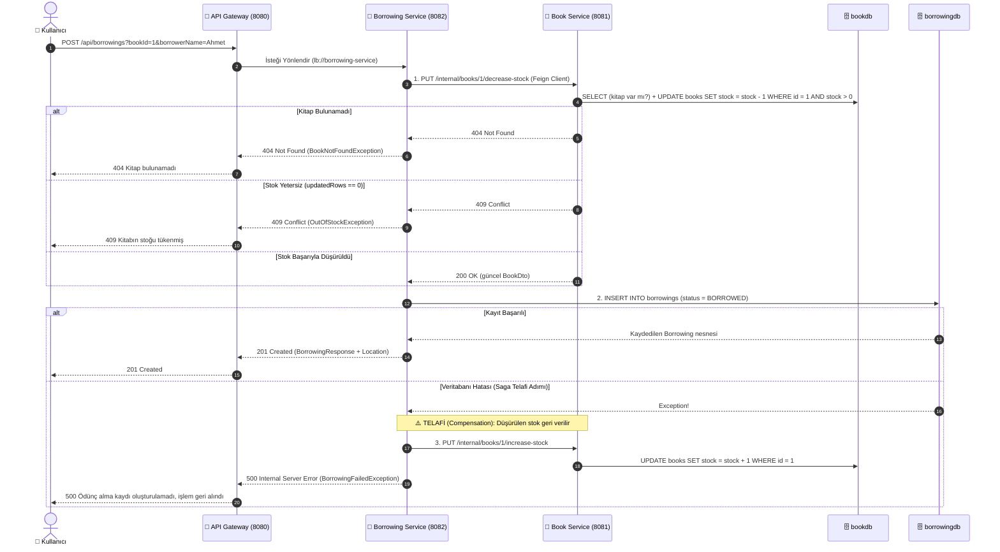
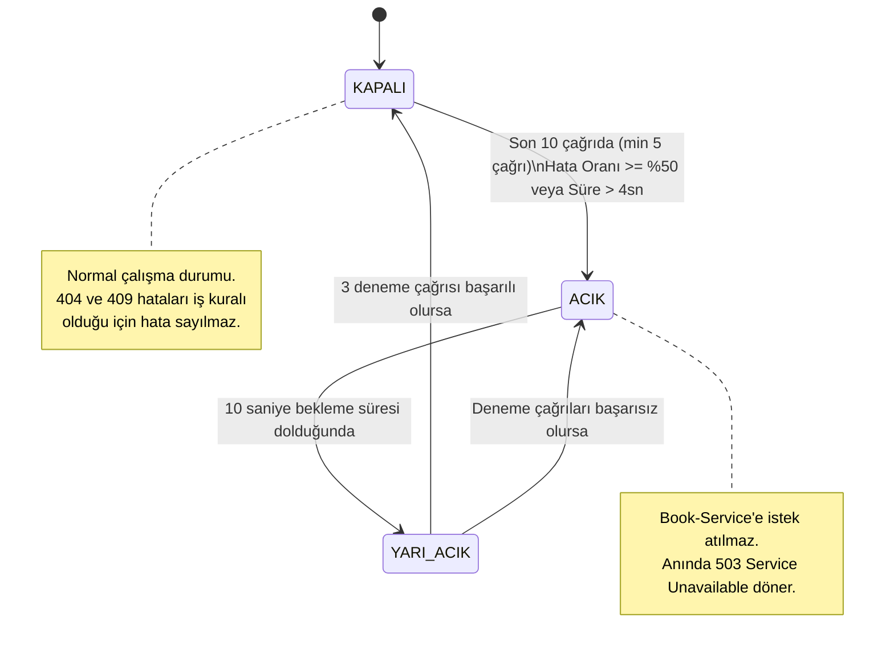

# 📚 Kütüphane Yönetim Sistemi — Mikroservis Mimarisi

Bu proje, modern **Spring Boot** ve **Spring Cloud** ekosistemini kullanarak geliştirilmiş, uçtan uca bir **Kütüphane Yönetim Sistemi** mikroservis uygulamasıdır. Sistem; kitap envanterinin yönetilmesi, stok takibi, üye yönetimi, kitap ödünç alma, süre uzatma, gecikme/ceza takibi ve iade süreçlerini birbirinden bağımsız ancak uyumlu çalışan **5 ayrı mikroservis** üzerinden gerçekleştirir.

Projede yalnızca temel CRUD işlemleri değil; gerçek dünya mikroservis mimarilerinde karşılaşılan **Servis Keşfi (Service Discovery)**, **Tek Giriş Noktası (API Gateway)**, **Yük Dengeleme (Load Balancing)**, **Devre Kesici (Circuit Breaker)**, **Dağıtık İşlem Telafisi (Saga Compensation)**, **Eşzamanlılık / Yarış Durumu Koruması (Atomic Stock Update)** ve **Merkezi Hata Yönetimi** gibi kritik mühendislik desenleri uygulanmıştır.

---

## 🧭 İçindekiler

1. [Sistem Mimarisi ve Genel Bakış](#-1-sistem-mimarisi-ve-genel-bakış)
2. [Kullanılan Teknolojiler](#-2-kullanılan-teknolojiler)
3. [Mikroservislerin Detaylı Açıklaması](#-3-mikroservislerin-detaylı-açıklaması)
   - [3.1. Discovery Server (Eureka)](#31-discovery-server-eureka--port-8761)
   - [3.2. API Gateway](#32-api-gateway--port-8080)
   - [3.3. Book Service (Kitap Servisi)](#33-book-service-kitap-servisi--port-8081)
   - [3.4. Borrowing Service (Ödünç Alma Servisi)](#34-borrowing-service-ödünç-alma-servisi--port-8082)
   - [3.5. Member Service (Üye Servisi)](#35-member-service-üye-servisi--port-8083)
4. [Uygulanan Mikroservis Tasarım Desenleri ve Mühendislik Çözümleri](#-4-uygulanan-mikroservis-tasarım-desenleri-ve-mühendislik-çözümleri)
5. [İş Akışı Diyagramları](#-5-iş-akışı-diyagramları)
6. [Proje Dizin Yapısı](#-6-proje-dizin-yapısı)
7. [Kurulum ve Çalıştırma Rehberi](#-7-kurulum-ve-çalıştırma-rehberi)
8. [API Dokümantasyonu ve Örnek İstekler (cURL)](#-8-api-dokümantasyonu-ve-örnek-istekler-curl)
9. [Veritabanı ve İzleme Panelleri](#-9-veritabanı-ve-izleme-panelleri)
10. [Hata Yönetimi ve HTTP Durum Kodları](#-10-hata-yönetimi-ve-http-durum-kodları)

---

## 🏗️ 1. Sistem Mimarisi ve Genel Bakış

Sistem 5 ana bileşenden oluşur:

| Servis Adı | Port | Veritabanı | Rolü ve Sorumluluğu |
| :--- | :---: | :---: | :--- |
| **`discovery-server`** | `8761` | Yok | **Netflix Eureka Server** — Tüm mikroservislerin kayıt olduğu ve birbirlerinin adreslerini dinamik olarak öğrendiği telefon rehberi. |
| **`api-gateway`** | `8080` | Yok | **Spring Cloud Gateway (WebFlux)** — Dış dünyadan gelen tüm isteklerin karşılandığı tek giriş kapısı. İstekleri ilgili servise yönlendirir. |
| **`book-service`** | `8081` | `H2 (bookdb)` | Kitap kayıtlarını, kategori/ISBN bilgilerini ve kopya/stok miktarlarını yöneten servis. |
| **`borrowing-service`** | `8082` | `H2 (borrowingdb)` | Kitap ödünç alma, süre uzatma, gecikme/ceza takibi ve iade işlemlerini yürüten; `OpenFeign` ile `book-service` ve `member-service` ile haberleşen servis. |
| **`member-service`** | `8083` | `H2 (memberdb)` | Kütüphane üyelerini, iletişim bilgilerini ve üyelik durumlarını (`ACTIVE` / `SUSPENDED`) yöneten servis. |



---

## 🛠️ 2. Kullanılan Teknolojiler

* **Dil:** Java 21
* **Çatı (Framework):** Spring Boot `4.1.x`
* **Mikroservis Ekosistemi:** Spring Cloud `2025.1.x`
  * **Servis Keşfi:** Spring Cloud Netflix Eureka (`Server` & `Client`)
  * **API Ağ Geçidi:** Spring Cloud Gateway Server (`WebFlux` / Reaktif)
  * **Servisler Arası İletişim:** Spring Cloud OpenFeign + Spring Cloud LoadBalancer
  * **Dayanıklılık (Fault Tolerance):** Spring Cloud CircuitBreaker (`Resilience4j` CircuitBreaker & TimeLimiter)
* **Veri Erişimi:** Spring Data JPA (Hibernate)
* **Veritabanı:** H2 In-Memory Database (Her servis için izole edilmiş ayrı şema)
* **Doğrulama:** Jakarta Bean Validation (`spring-boot-starter-validation`)
* **Gözlemlenebilirlik:** Spring Boot Actuator
* **Yardımcı Kütüphaneler:** Project Lombok, SLF4J Logging
* **Derleme ve Paketleme:** Apache Maven (`mvnw` / Maven Wrapper dahil)

---

## 🔍 3. Mikroservislerin Detaylı Açıklaması

### 3.1. `discovery-server` (Eureka) — Port: `8761`

Mikroservis mimarisinde servislerin IP adresleri ve portları dinamik olarak değişebilir veya aynı servisten birden fazla kopya (instance) ayağa kaldırılabilir. `discovery-server`, **Netflix Eureka Server** olarak çalışır ve sistemdeki tüm servislerin adres defterini tutar.

* **Ana Sınıf:** `DiscoveryServerApplication.java` (`@EnableEurekaServer` anotasyonu ile aktif edilir).
* **Önemli Ayarlar (`application.properties`):**
  * `server.port=8761` (Eureka'nın standart portu).
  * `eureka.client.register-with-eureka=false` ve `eureka.client.fetch-registry=false`: Sunucunun kendi kendisine bir istemci gibi kayıt olmaya çalışmasını engeller.

---

### 3.2. `api-gateway` — Port: `8080`

İstemcilerin (`Frontend`, `Mobil Uygulama`, `Postman` vb.) arkadaki mikroservislerin portlarını (`8081`, `8082`) bilmesine gerek kalmadan **tek bir kapıdan (`http://localhost:8080`)** sisteme erişmesini sağlar.

* **Reaktif Mimari:** `spring-cloud-starter-gateway-server-webflux` bağımlılığı ile bloklamayan (non-blocking) yapıda çalışır.
* **Dinamik Yönlendirme ve Yük Dengeleme (`application.yml`):**
  * `/api/books/**` adresine gelen istekleri `lb://book-service` üzerinden `book-service` örneklerine yönlendirir.
  * `/api/borrowings/**` adresine gelen istekleri `lb://borrowing-service` üzerinden `borrowing-service` örneklerine yönlendirir.
  * `/api/members/**` adresine gelen istekleri `lb://member-service` üzerinden `member-service` örneklerine yönlendirir.
  * `lb://` (Load Balanced) öneki sayesinde Gateway, hedef servisin adresini Eureka'dan öğrenir ve birden fazla örnek varsa yükü aralarında paylaştırır.
* **Global CORS Yapılandırması:** Tarayıcı tabanlı önyüz uygulamalarının (`http://localhost:*`) `GET`, `POST`, `PUT`, `DELETE`, `OPTIONS` isteklerini sorunsuz gönderebilmesi için CORS izinleri tanımlanmıştır.
* **Actuator Desteği:** `/actuator/health`, `/actuator/info` ve `/actuator/gateway/routes` uç noktaları açıktır.
* **İç Uç Noktaların Gizlenmesi:** Servisler arası uç noktalar (`/internal/**`) için bilerek **hiçbir rota tanımlanmamıştır**. Böylece stok değiştiren uç noktalar dış dünyadan (`8080`) çağrılamaz; `404` döner.
* **`PreserveHostHeader` Filtresi:** İstemcinin `Host` başlığı servislere aynen iletilir. Böylece `201 Created` yanıtlarındaki `Location` adresi servisin kendi adresini değil, Gateway adresini (`http://localhost:8080/...`) gösterir.

---

### 3.3. `book-service` (Kitap Servisi) — Port: `8081`

Kütüphanedeki kitapların kaydını ve mevcut stok durumunu yönetir. Temiz ve modüler bir **Katmanlı Mimari (Layered Architecture)** ile tasarlanmıştır:

* **`entity/Book.java`**: `books` tablosunu temsil eder (`id`, `title`, `author`, `isbn`, `category`, `publishYear`, `stock`, `totalCopies`).
* **`dto/BookRequest.java`**: Kitap ekleme ve güncelleme isteklerinde dışarıdan gelen alanları doğrular (`@NotBlank`, `@NotNull`, `@Min`, `@Max`).
* **`repository/BookRepository.java`**:
  * `searchBooks(...)`: Başlık, yazar ve kategoriye göre büyük/küçük harf duyarsız arama ve sayfalama (`Page<Book>`) yapar.
  * `existsByIsbnIgnoreCase(...)`: Aynı ISBN numarasıyla ikinci bir kitap kaydedilmesini önler.
  * `decreaseStockIfAvailable(Long id)`: `UPDATE Book b SET b.stock = b.stock - 1 WHERE b.id = :id AND b.stock > 0` sorgusu ile stok kontrolünü ve stok düşürme işlemini **tek bir atomik SQL sorgusunda** gerçekleştirir.
  * `increaseStock(Long id)`: İade veya telafi durumlarında stoğu 1 artırır.
* **`service/BookService.java`**: İş kurallarını barındırır. Kitap bulunamadığında `BookNotFoundException` (`404`), stok tükendiğinde `OutOfStockException` (`409`), aynı ISBN kullanıldığında `DuplicateIsbnException` (`409`), ödünçte kopyası bulunan kitap silinmeye/kopyası azaltılmaya çalışıldığında `BookInUseException` (`409`) fırlatır.
* **`dto/BookResponse.java`**: İstemciye dönen kitap verisi (`record`; `stock`, `totalCopies` ve `availableCopies` dahil). Entity dışarıya açılmaz.
* **`controller/BookController.java`**: `/api/books` altındaki **dışa açık** uç noktalar (ekleme, arama/sayfalama, getirme, güncelleme, silme). Listelemede `X-Total-Count` ve `X-Total-Pages` başlıklarını, eklemede `201 Created` + `Location` başlığını döner.
* **`controller/InternalBookController.java`**: `/internal/books` altındaki **servisler arası** stok uç noktaları (`decrease-stock`, `increase-stock`). Yalnızca `borrowing-service` tarafından çağrılır; API Gateway üzerinden erişilemez.
* **`exception/GlobalExceptionHandler.java`**: Servis genelinde fırlatılan özel istisnaları ve doğrulama hatalarını yakalayarak standart `ErrorResponse` JSON formatında döner.

---

### 3.4. `borrowing-service` (Ödünç Alma Servisi) — Port: `8082`

Kullanıcıların kitap ödünç alma, süre uzatma, gecikme/ceza takibi ve iade etme süreçlerini koordine eder.

* **Bağımsız Veritabanı (`borrowingdb`):** Mikroservis prensiplerine uygun olarak `book-service` ve `member-service` veritabanlarına doğrudan bağlanmaz. Yalnızca `bookId`, `memberId`, `bookTitle`, `borrowerName`, `dueDate`, `renewCount`, `lateFee` ve durum bilgisini kendi `borrowings` tablosunda saklar.
* **Durum Takibi (`BorrowingStatus`):** Her ödünç kaydı `BORROWED` (Ödünç Alındı), `OVERDUE` (Teslim Süresi Geçti) veya `RETURNED` (İade Edildi) durumlarından birine sahiptir. `@Scheduled` görev ile süresi geçen kayıtlar otomatik olarak `OVERDUE` işaretlenir ve günlük gecikme cezası (`borrowing.daily-late-fee`, varsayılan `5.0 TL/gün`) hesaplanır.
* **Ödünç Alma Kuralları:**
  * Üye `memberId` ile gelirse `MemberClient` üzerinden üyeliğin `ACTIVE` olup olmadığı doğrulanır (`SUSPENDED` üyeler alamaz).
  * Gecikmiş (`OVERDUE`) kitabı bulunan üye yeni kitap ödünç alamaz (`409 Conflict`).
  * Aynı üye aynı kitabı iade etmeden ikinci kez ödünç alamaz (`409 Conflict`).
  * Bir üye aynı anda en fazla **3** aktif kitap ödünç alabilir (`409 Conflict`).
  * Süre uzatma (`PUT /api/borrowings/{id}/renew`) en fazla **1 kez** (+7 gün) yapılabilir; gecikmiş veya iade edilmiş kitaplar uzatılamaz (`409 Conflict`).
* **`BookClient` & `MemberClient` (OpenFeign):** Hiçbir sabit IP veya port yazmadan Eureka üzerinden `book-service` (`/internal/books`) ve `member-service` (`/api/members`) ile haberleşir.
* **`dto/BorrowingResponse.java`**: İstemciye dönen ödünç kaydı verisi (`record`). Entity dışarıya açılmaz.
* **`BookClientErrorDecoder`:** Hem `BookClient` hem de `MemberClient` çağrılarından dönen HTTP hata yanıtlarını yakalar ve anlamlı istisnalara (`BookNotFoundException`, `MemberNotFoundException`, `OutOfStockException`) dönüştürür.
* **`ResilienceConfig` & Fallback Factory'ler:** Hedef servisler çöktüğünde, yavaşladığında veya ağ hatası oluştuğunda devreye girerek `503 Service Unavailable` döner.

---

### 3.5. `member-service` (Üye Servisi) — Port: `8083`

Kütüphane üyelerinin kayıt, güncelleme, durum yönetimi ve silme işlemlerini yönetir.

* **`entity/Member.java` & `MemberStatus`:** `members` tablosunu temsil eder (`id`, `name`, `email` [unique], `phone`, `membershipDate`, `status`: `ACTIVE` / `SUSPENDED`).
* **`service/MemberService.java`:** Aynı e-posta ile ikinci kayıt yapılmasını `DuplicateEmailException` (`409`) ile engeller, üye bulunamazsa `MemberNotFoundException` (`404`) fırlatır.
* **`controller/MemberController.java`:** `/api/members` altında üye CRUD ve `/api/members/{id}/status` uç noktalarını sunar.

---

## 🧠 4. Uygulanan Mikroservis Tasarım Desenleri ve Mühendislik Çözümleri

### 1. Database per Service (Servis Başına Veritabanı)
Her mikroservis kendi verisinin tek sahibidir:
* `book-service` ➡️ `jdbc:h2:mem:bookdb`
* `borrowing-service` ➡️ `jdbc:h2:mem:borrowingdb`
* `member-service` ➡️ `jdbc:h2:mem:memberdb`
İki servis birbirinin tablolarına doğrudan erişemez; veri alışverişi yalnızca iyi tanımlanmış REST API sözleşmeleri üzerinden yapılır.

### 2. Atomik Stok Güncellemesi (Race Condition Önleme)
Klasik "Önce kitabı oku (`SELECT`) ➡️ Stok > 0 mı kontrol et ➡️ Bellekte `stock - 1` yap ➡️ Kaydet (`UPDATE`)" yaklaşımında, aynı anda son kitabı ödünç almak isteyen iki kişiden ikisi de stoğu `1` görüp stoğu `-1`'e düşürebilir (**Race Condition**).

Bu projede stok kontrolü ve azaltma işlemi veritabanı seviyesinde **atomik** olarak yapılır:
```sql
UPDATE Book b SET b.stock = b.stock - 1 WHERE b.id = :id AND b.stock > 0
```
Veritabanı bu satır güncellemesini kilitler (row-level locking). Etkilenen satır sayısı `0` dönerse, stok kalmadığı kesin olarak anlaşılır ve `409 Conflict` (`OutOfStockException`) fırlatılır.

### 3. Saga Pattern — Telafi Edici İşlemler (Compensating Transactions)
Mikroservislerde her servisin kendi veritabanı olduğu için tek bir `@Transactional` anotasyonu ile iki ayrı veritabanındaki işlemi geri almak (rollback) mümkün değildir.
`BorrowingService` içinde **Saga Orchestration / Telafi (Compensation)** yaklaşımı uygulanmıştır:
* **Ödünç Alma Telafisi:** `book-service`'te stok başarıyla düşürüldükten sonra `borrowing-service` kendi veritabanına ödünç kaydını yazarken bir hata alırsa, `compensateIncreaseStock(bookId)` metodu çağrılarak `book-service`'teki stok otomatik olarak geri artırılır.
* **İade Etme Telafisi:** İade sırasında `book-service`'te stok artırıldıktan sonra `borrowing-service`'teki kayıt `RETURNED` olarak güncellenemezse, `compensateDecreaseStock(bookId)` çağrılarak artırılan stok geri düşürülür.

### 4. Circuit Breaker (Devre Kesici) ve Zaman Aşımı (Timeouts)
`borrowing-service`, `book-service`'i çağırırken `book-service` yanıt vermezse tüm sistemin kilitlenmesini önlemek için çok katmanlı koruma kullanır:
* **Feign Zaman Aşımları:** Bağlantı kurma süresi (`connect-timeout`) en fazla **2 saniye**, yanıt okuma süresi (`read-timeout`) en fazla **3 saniye** ile sınırlandırılmıştır.
* **Resilience4j Devre Kesici (`ResilienceConfig.java`):**
  * Son **10 çağrıyı** (`slidingWindowSize = 10`) izler (en az **5 çağrı** yapıldıktan sonra karar verir).
  * Çağrıların **%50 veya daha fazlası** başarısız olursa (veya **4 saniyelik** `TimeLimiter` süresini aşarsa) devre **AÇIK (OPEN)** konumuna geçer ("sigorta atar").
  * **AÇIK** konumda **10 saniye** boyunca `book-service`'e hiç istek gönderilmez; anında `BookClientFallbackFactory` devreye girer.
  * 10 saniye sonunda devre **YARI AÇIK (HALF-OPEN)** durumuna geçer ve **3 deneme isteğine** izin verir. Başarılı olursa devre tekrar **KAPALI (CLOSED)** (normal) duruma döner.
  * **Akıllı İstisna Filtreleme (`ignoreExceptions`):** `BookNotFoundException` (`404`) ve `OutOfStockException` (`409`) birer sistem arızası değil, normal iş kuralı sonucu olduğu için devre kesicinin hata oranına **dahil edilmez**.

---

## 🔄 5. İş Akışı Diyagramları

### 5.1. Kitap Ödünç Alma ve Saga Telafi Akışı



### 5.2. Devre Kesici (Circuit Breaker) Durum Diyagramı



---

## 📂 6. Proje Dizin Yapısı

```text
kutuphane-mikroservis/
├── discovery-server/                  # Eureka Server (Port: 8761)
│   ├── src/main/java/com/kutuphane/discoveryserver/
│   │   └── DiscoveryServerApplication.java
│   ├── src/main/resources/
│   │   └── application.properties
│   └── pom.xml
│
├── api-gateway/                       # Spring Cloud Gateway (Port: 8080)
│   ├── src/main/java/com/kutuphane/apigateway/
│   │   └── ApiGatewayApplication.java
│   ├── src/main/resources/
│   │   └── application.yml
│   └── pom.xml
│
├── book-service/                      # Kitap Mikroservisi (Port: 8081)
│   ├── src/main/java/com/kutuphane/bookservice/
│   │   ├── controller/
│   │   │   ├── BookController.java           # Dışa açık: /api/books (CRUD + arama)
│   │   │   └── InternalBookController.java   # Servisler arası: /internal/books (stok)
│   │   ├── dto/
│   │   │   ├── BookRequest.java
│   │   │   └── BookResponse.java
│   │   ├── entity/Book.java
│   │   ├── exception/
│   │   │   ├── BookInUseException.java
│   │   │   ├── BookNotFoundException.java
│   │   │   ├── DuplicateIsbnException.java
│   │   │   ├── ErrorResponse.java
│   │   │   ├── GlobalExceptionHandler.java
│   │   │   └── OutOfStockException.java
│   │   ├── repository/BookRepository.java
│   │   ├── service/BookService.java
│   │   └── BookServiceApplication.java
│   ├── src/main/resources/
│   │   └── application.properties
│   └── pom.xml
│
├── borrowing-service/                 # Ödünç Alma Mikroservisi (Port: 8082)
│   ├── src/main/java/com/kutuphane/borrowingservice/
│   │   ├── client/
│   │   │   ├── BookClient.java
│   │   │   ├── BookClientErrorDecoder.java
│   │   │   ├── BookClientFallbackFactory.java
│   │   │   ├── MemberClient.java
│   │   │   └── MemberClientFallbackFactory.java
│   │   ├── config/ResilienceConfig.java
│   │   ├── controller/BorrowingController.java
│   │   ├── dto/
│   │   │   ├── BookDto.java
│   │   │   ├── BorrowingResponse.java
│   │   │   └── MemberDto.java
│   │   ├── entity/
│   │   │   ├── Borrowing.java
│   │   │   └── BorrowingStatus.java
│   │   ├── exception/
│   │   │   ├── BookAlreadyReturnedException.java
│   │   │   ├── BookNotFoundException.java
│   │   │   ├── BookServiceUnavailableException.java
│   │   │   ├── BorrowingFailedException.java
│   │   │   ├── BorrowingNotFoundException.java
│   │   │   ├── BorrowingRuleViolationException.java
│   │   │   ├── ErrorResponse.java
│   │   │   ├── GlobalExceptionHandler.java
│   │   │   ├── MemberNotFoundException.java
│   │   │   ├── MemberServiceUnavailableException.java
│   │   │   └── OutOfStockException.java
│   │   ├── repository/BorrowingRepository.java
│   │   ├── service/BorrowingService.java
│   │   └── BorrowingServiceApplication.java
│   ├── src/main/resources/
│   │   └── application.properties
│   └── pom.xml
│
└── member-service/                    # Üye Mikroservisi (Port: 8083)
    ├── src/main/java/com/kutuphane/memberservice/
    │   ├── controller/MemberController.java
    │   ├── dto/
    │   │   ├── MemberRequest.java
    │   │   └── MemberResponse.java
    │   ├── entity/
    │   │   ├── Member.java
    │   │   └── MemberStatus.java
    │   ├── exception/
    │   │   ├── DuplicateEmailException.java
    │   │   ├── ErrorResponse.java
    │   │   ├── GlobalExceptionHandler.java
    │   │   └── MemberNotFoundException.java
    │   ├── repository/MemberRepository.java
    │   ├── service/MemberService.java
    │   └── MemberServiceApplication.java
    ├── src/main/resources/
    │   └── application.properties
    └── pom.xml
```

---

## 🚀 7. Kurulum ve Çalıştırma Rehberi

### Ön Gereksinimler
* **Java 21 (JDK 21)** kurulu olmalıdır (`java -version` ile kontrol edebilirsiniz).
* Her proje klasöründe **Maven Wrapper (`mvnw` / `mvnw.cmd`)** yer aldığı için bilgisayarınızda ayrıca Maven kurulu olmasına gerek yoktur.

### ⚠️ Çalıştırma Sırası (Çok Önemli!)
Servislerin birbirini bulabilmesi için **mutlaka aşağıdaki sırayla** ayağa kaldırılması önerilir:

#### 1. Adım: Discovery Server'ı Başlatın (`Port: 8761`)
```powershell
cd discovery-server
.\mvnw.cmd spring-boot:run
```
> Tarayıcıdan `http://localhost:8761` adresine giderek Eureka panelinin açıldığını doğrulayın.

#### 2. Adım: Book Service'i Başlatın (`Port: 8081`)
Yeni bir terminal açın:
```powershell
cd book-service
.\mvnw.cmd spring-boot:run
```

#### 3. Adım: Member Service'i Başlatın (`Port: 8083`)
Yeni bir terminal açın:
```powershell
cd member-service
.\mvnw.cmd spring-boot:run
```

#### 4. Adım: Borrowing Service'i Başlatın (`Port: 8082`)
Yeni bir terminal açın:
```powershell
cd borrowing-service
.\mvnw.cmd spring-boot:run
```

#### 5. Adım: API Gateway'i Başlatın (`Port: 8080`)
Yeni bir terminal açın:
```powershell
cd api-gateway
.\mvnw.cmd spring-boot:run
```

> Tüm servisler başladıktan sonra `http://localhost:8761` adresindeki Eureka panelinde **`API-GATEWAY`**, **`BOOK-SERVICE`**, **`BORROWING-SERVICE`** ve **`MEMBER-SERVICE`** uygulamalarının **`UP`** durumunda göründüğünden emin olun.

---

## 📡 8. API Dokümantasyonu ve Örnek İstekler (cURL)

Tüm istekler **API Gateway (`http://localhost:8080`)** üzerinden yapılır.

### 📘 Kitap İşlemleri (`book-service`)

#### 1. Yeni Kitap Ekle
* **Endpoint:** `POST /api/books`
* **Örnek İstek:**
```bash
curl -X POST http://localhost:8080/api/books \
  -H "Content-Type: application/json" \
  -d '{
    "title": "Suç ve Ceza",
    "author": "Fyodor Dostoyevski",
    "isbn": "978-975-07-1938-7",
    "category": "Roman",
    "publishYear": 1866,
    "stock": 3,
    "totalCopies": 3
  }'
```
* **Örnek Yanıt (`201 Created`):** *(Yanıt başlığında `Location: http://localhost:8080/api/books/1` döner.)*
```json
{
  "id": 1,
  "title": "Suç ve Ceza",
  "author": "Fyodor Dostoyevski",
  "isbn": "978-975-07-1938-7",
  "category": "Roman",
  "publishYear": 1866,
  "stock": 3,
  "totalCopies": 3,
  "availableCopies": 3
}
```

#### 2. Kitapları Listele, Ara ve Sayfala
* **Endpoint:** `GET /api/books` *(Opsiyonel parametreler: `title`, `author`, `category`, `page`, `size`; yanıt başlıklarında `X-Total-Count` ve `X-Total-Pages` döner)*
```bash
curl -X GET "http://localhost:8080/api/books?title=suç&page=0&size=10"
```

#### 3. ID'ye Göre Kitap Getir
* **Endpoint:** `GET /api/books/{id}`
```bash
curl -X GET http://localhost:8080/api/books/1
```

#### 4. Kitap Güncelle
* **Endpoint:** `PUT /api/books/{id}`
```bash
curl -X PUT http://localhost:8080/api/books/1 \
  -H "Content-Type: application/json" \
  -d '{
    "title": "Suç ve Ceza (Ciltli)",
    "author": "Fyodor Dostoyevski",
    "isbn": "978-975-07-1938-7",
    "category": "Klasik Roman",
    "publishYear": 1866,
    "stock": 5,
    "totalCopies": 5
  }'
```

#### 5. Kitap Sil
* **Endpoint:** `DELETE /api/books/{id}` *(Ödünçte kopyası yoksa `204 No Content`, varsa `409 Conflict` döner)*
```bash
curl -X DELETE http://localhost:8080/api/books/1
```

> [!NOTE]
> Stok değiştiren uç noktalar (`PUT /internal/books/{id}/decrease-stock` ve `PUT /internal/books/{id}/increase-stock`) **servisler arası** kullanım içindir. API Gateway'de bu yol için rota tanımlı olmadığından `8080` üzerinden çağrılamaz (`404`). Stok yalnızca ödünç alma / iade işlemleriyle değişir.

---

### 👤 Üye İşlemleri (`member-service`)

#### 1. Yeni Üye Ekle
* **Endpoint:** `POST /api/members`
```bash
curl -X POST http://localhost:8080/api/members \
  -H "Content-Type: application/json" \
  -d '{
    "name": "Ahmet Yılmaz",
    "email": "ahmet@example.com",
    "phone": "05551112233"
  }'
```
* **Örnek Yanıt (`201 Created`):** *(Yanıt başlığında `Location: http://localhost:8080/api/members/1` döner.)*
```json
{
  "id": 1,
  "name": "Ahmet Yılmaz",
  "email": "ahmet@example.com",
  "phone": "05551112233",
  "membershipDate": "2026-11-18",
  "status": "ACTIVE"
}
```

#### 2. Üyeleri Listele / Getir / Güncelle / Durum Değiştir / Sil
* `GET /api/members` — Tüm üyeleri listele
* `GET /api/members/{id}` — ID'ye göre üye getir
* `PUT /api/members/{id}` — Üye bilgilerini güncelle
* `PUT /api/members/{id}/status?status=SUSPENDED` — Üyeyi askıya al veya `ACTIVE` yap
* `DELETE /api/members/{id}` — Üyeyi sil (`204 No Content`)

---

### 📙 Ödünç Alma ve İade İşlemleri (`borrowing-service`)

#### 1. Kitap Ödünç Al
* **Endpoint:** `POST /api/borrowings`
* **Sorgu Parametreleri (Query Params):**
  * `bookId` (Zorunlu, Pozitif tam sayı)
  * `memberId` (Önerilen, Pozitif tam sayı — `member-service`'ten doğrulanır)
  * `borrowerName` (Opsiyonel — `memberId` verilmediyse zorunlu)
  * `durationDays` (Opsiyonel — varsayılan `14` gün)
* **Örnek İstek:**
```bash
curl -X POST "http://localhost:8080/api/borrowings?bookId=1&memberId=1"
```
* **Örnek Yanıt (`201 Created`):** *(Yanıt başlığında `Location: http://localhost:8080/api/borrowings/1` döner.)*
```json
{
  "id": 1,
  "bookId": 1,
  "bookTitle": "Suç ve Ceza",
  "memberId": 1,
  "borrowerName": "Ahmet Yılmaz",
  "borrowDate": "2026-11-18",
  "dueDate": "2026-12-02",
  "returnDate": null,
  "renewCount": 0,
  "lateFee": 0.0,
  "status": "BORROWED"
}
```
*(Bu işlem sonunda `book-service`'teki ilgili kitabın stoğu otomatik olarak `3` ➡️ `2` olur.)*

#### 2. Ödünç Süresini Uzat
* **Endpoint:** `PUT /api/borrowings/{id}/renew` *(En fazla 1 kez +7 gün uzatılır; gecikmiş kitap uzatılamaz)*
```bash
curl -X PUT http://localhost:8080/api/borrowings/1/renew
```

#### 3. Kitap İade Et
* **Endpoint:** `PUT /api/borrowings/{id}/return`
* **Örnek İstek:**
```bash
curl -X PUT http://localhost:8080/api/borrowings/1/return
```
* **Örnek Yanıt (`200 OK`):**
```json
{
  "id": 1,
  "bookId": 1,
  "bookTitle": "Suç ve Ceza",
  "memberId": 1,
  "borrowerName": "Ahmet Yılmaz",
  "borrowDate": "2026-11-18",
  "dueDate": "2026-12-02",
  "returnDate": "2026-11-18",
  "renewCount": 0,
  "lateFee": 0.0,
  "status": "RETURNED"
}
```
*(Bu işlem sonunda `book-service`'teki ilgili kitabın stoğu otomatik olarak `2` ➡️ `3` olur, gecikme varsa `lateFee` hesaplanır.)*

#### 4. Ödünç Kayıtlarını Listele / Filtrele
* **Endpoint:** `GET /api/borrowings` *(Opsiyonel filtreler: `?status=BORROWED|OVERDUE|RETURNED&memberId=1`)*
```bash
curl -X GET "http://localhost:8080/api/borrowings?status=OVERDUE&memberId=1"
```

#### 5. ID'ye Göre Ödünç Kaydı Getir
* **Endpoint:** `GET /api/borrowings/{id}`
```bash
curl -X GET http://localhost:8080/api/borrowings/1
```

---

## 🖥️ 9. Veritabanı ve İzleme Panelleri

Uygulama çalışırken aşağıdaki yönetim ve izleme ekranlarına tarayıcı üzerinden ulaşabilirsiniz:

| Panel / Araç | URL | Ek Bilgiler |
| :--- | :--- | :--- |
| **Eureka Dashboard** | `http://localhost:8761` | Kayıtlı tüm mikroservisleri ve durumlarını gösterir. |
| **API Gateway Rotaları** | `http://localhost:8080/actuator/gateway/routes` | Gateway üzerinde tanımlı aktif yönlendirme kurallarını JSON olarak listeler. |
| **API Gateway Sağlık Durumu** | `http://localhost:8080/actuator/health` | Gateway'in çalışma durumunu gösterir. |
| **Book-Service Sağlık Durumu** | `http://localhost:8081/actuator/health` | Servis ve veritabanı (`db`) sağlık detaylarını gösterir. |
| **Borrowing-Service Sağlık Durumu** | `http://localhost:8082/actuator/health` | Servis ve veritabanı (`db`) sağlık detaylarını gösterir. |
| **Member-Service Sağlık Durumu** | `http://localhost:8083/actuator/health` | Servis ve veritabanı (`db`) sağlık detaylarını gösterir. |
| **Book-Service H2 Console** | `http://localhost:8081/h2-console` | **JDBC URL:** `jdbc:h2:mem:bookdb`<br>**User Name:** `sa`<br>**Password:** *(boş bırakın)* |
| **Borrowing-Service H2 Console** | `http://localhost:8082/h2-console` | **JDBC URL:** `jdbc:h2:mem:borrowingdb`<br>**User Name:** `sa`<br>**Password:** *(boş bırakın)* |
| **Member-Service H2 Console** | `http://localhost:8083/h2-console` | **JDBC URL:** `jdbc:h2:mem:memberdb`<br>**User Name:** `sa`<br>**Password:** *(boş bırakın)* |

---

## ⚠️ 10. Hata Yönetimi ve HTTP Durum Kodları

`book-service`, `borrowing-service` ve `member-service` üzerinde `@RestControllerAdvice` tabanlı merkezi hata yakalayıcı (`GlobalExceptionHandler`) bulunur. Tüm hatalar istemciye aşağıdaki standart JSON şemasıyla (`ErrorResponse`) döndürülür:

```json
{
  "status": 409,
  "error": "Conflict",
  "message": "'Suç ve Ceza' adlı kitabın stoğu tükenmiş!",
  "timestamp": "2026-11-15T16:45:12.345678"
}
```

| HTTP Kodu | Durum | Fırlatıldığı Senaryolar |
| :---: | :--- | :--- |
| **`400`** | `Bad Request` | Eksik veya geçersiz parametre/gövde gönderildiğinde (Örn: Boş kitap adı, geçersiz e-posta, negatif stok, `memberId` ve `borrowerName`'in ikisinin de boş olması). |
| **`404`** | `Not Found` | İstenen `bookId`, `memberId` veya `borrowingId` veritabanında bulunamadığında (`BookNotFoundException`, `MemberNotFoundException`, `BorrowingNotFoundException`). |
| **`409`** | `Conflict` | Stok tükenmesi (`OutOfStockException`), çift iade (`BookAlreadyReturnedException`), aynı ISBN/e-posta (`DuplicateIsbnException`, `DuplicateEmailException`), ödünçte kitap silme (`BookInUseException`), max 3 aktif ödünç / gecikmiş kitap / aynı kitabı tekrar alma / uzatma limiti (`BorrowingRuleViolationException`). |
| **`500`** | `Internal Server Error` | Ödünç veya iade kaydı veritabanına yazılamayıp Saga telafi adımı çalıştırıldığında (`BorrowingFailedException`). |
| **`503`** | `Service Unavailable` | `book-service` veya `member-service` kapalı olduğunda, zaman aşımına uğradığında veya **Circuit Breaker** açık olduğunda (`BookServiceUnavailableException`, `MemberServiceUnavailableException`). |
